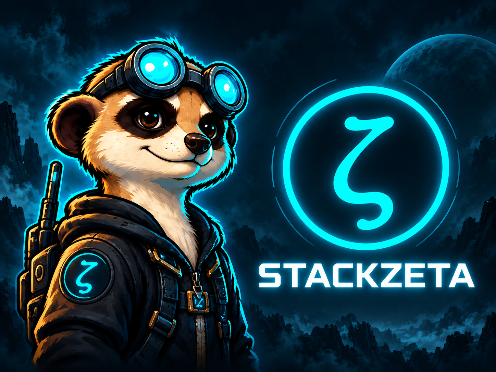
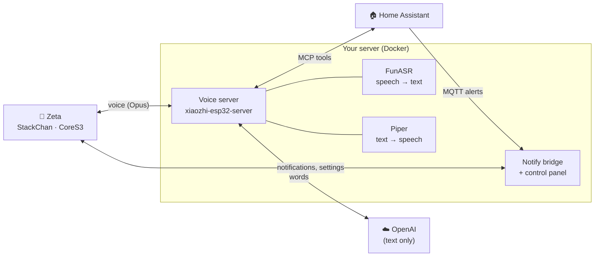

<p align="center">
  
</p>

<h1 align="center">StackZeta</h1>

<p align="center">
  <b>A little desk robot that listens, talks back, runs your smart home, and keeps your secrets.</b><br>
  Custom firmware and a self-hosted brain for the M5Stack StackChan.
</p>

<p align="center">
  
  
  
  
  <a href="LICENSE"></a>
</p>

---

## Meet Zeta

Zeta lives on your desk. Say *"Hi StackChan"*, or just walk up to it, and it wakes up, nods along as you talk, and chats back with a mouth that moves in time with its voice. Ask it to dim the
living room lights, what the weather's doing outside, or what you talked about yesterday.

When your doorbell rings or the washing machine finishes, Home Assistant can hand Zeta a message.
Zeta waits politely until you've finished talking, then shows it (with a camera snapshot if you like) and reads
it aloud. Anything urgent gets through straight away.

And it all runs on hardware you own. Your voice is turned into text **on your own server**, not in
someone else's cloud. Only the words go out to the AI, and a **privacy mode** shuts the microphone off completely, with a red glow so you always know.

## What it can do

| | |
|---|---|
| 🗣️ **Talk naturally** | Wake word, walk-up proximity wake, or tap to talk. An English persona with expressive faces and real lip-sync driven by its own voice. |
| 🏠 **Run your home** | Controls lights and devices by name or room through Home Assistant's built-in MCP server. No custom integration needed. |
| 🔔 **Deliver notifications** | Any Home Assistant automation can send spoken, on-screen alerts with images. Categories, quiet hours, Do Not Disturb, and urgent alerts that cut through. |
| 🌦️ **Know where "here" is** | Weather and local questions come from your Home Assistant home location, never from IP geolocation. |
| 🧠 **Remember you** | Conversations are summarised and remembered across sessions, stored on your server. |
| 🎛️ **Be tuned from a browser** | A signed-in control panel on your LAN for personality, volume, brightness, standby, LED colours, notification rules, and API keys. |
| 😴 **Rest when you do** | Quiet, balanced or lively idle personalities; it dozes off, parks its head and switches the screen off when left alone. |
| 🔒 **Stop listening, properly** | Privacy mode, enforced on the robot *and* on the server. More below. |

## Private by design

StackZeta started life as a stock StackChan, and a full audit of its firmware and voice server
turned up a lot of unexpected traffic: an IP-geolocation lookup to a Chinese service on every conversation, a
camera feature wired to a Chinese cloud AI, conversation summaries routed to another, a hardcoded
Chinese time server, and cloud-only apps. All of it is removed or blocked.

What's left is a simple rule: **Zeta talks to your own network and to OpenAI, and nothing else**
(apart from a public time server to set its clock).

- 🎙️ **Audio stays home.** Speech recognition ([FunASR](https://github.com/modelscope/FunASR)) and speech
  synthesis ([Piper](https://github.com/rhasspy/piper)) run locally. Only the transcribed text is sent
  to the AI, plus a photo if you explicitly ask Zeta to look at something.
- 🔴 **Privacy mode means it.** The LED ring turns red; the wake word, walk-up wake, tap-to-talk and
  camera stop. The robot remembers the setting through reboots. As a second, independent lock, the voice server refuses
  audio and hangs up while privacy is on, so even a misbehaving device can't be heard.
- 🧱 **An allow list on the device itself.** The robot checks its outbound connections (updates, voice, notification media, camera) against a host policy you control.
- 🔑 **Keys you can't read back.** API keys and tokens live in the control panel as write-only
  values on your server. They're never in git, never shown again, and never sent to the robot.

The full audit trail lives in [`backend/README.md`](backend/README.md#privacy--network-audit-v02).

## How it works



- **The robot** runs a fork of [m5stack/StackChan](https://github.com/m5stack/StackChan) with
  [xiaozhi-esp32](https://github.com/78/xiaozhi-esp32) as its voice client. It's kept in
  [`firmware/`](firmware/README.md) as one patch against a pinned upstream commit.
- **The server** is a Docker Compose stack: the
  [xiaozhi-esp32-server](https://github.com/xinnan-tech/xiaozhi-esp32-server) voice pipeline, a
  Piper TTS sidecar, and a small notify bridge that relays Home Assistant alerts and hosts the
  control panel.
- **Home Assistant** stays where it is. Zeta reaches it through HA's own MCP Server integration
  and an MQTT topic.

Curious about the internals? [`docs/firmware-changes.md`](docs/firmware-changes.md) walks through
every change, file by file.

## Get started

**You'll need:** an M5Stack StackChan kit (CoreS3 head), a Linux machine with Docker on your
network, Home Assistant with an MQTT broker, and an OpenAI API key.

1. **Start the server.** Follow [`backend/README.md`](backend/README.md#setup): copy the three
   example configs, download the speech model, and run `docker compose up -d --build`.
2. **Sign in to the control panel** at `http://<your-server>:8090`. The first-run password is in
   `docker logs notify-bridge | grep password`. Paste your OpenAI key and Home Assistant token into
   the **Keys** tab.
3. **Build and flash Zeta.** Run `firmware/setup.sh`, set your server's IP in
   `upstream/StackChan/firmware/sdkconfig.defaults.local`, then build and flash with Docker as in
   [`docs/toolchain.md`](docs/toolchain.md). Take a [flash backup](backups/README.md) first.
4. **Connect Home Assistant.** Enable the Model Context Protocol Server integration, and point
   automations at the MQTT topic to send Zeta notifications (examples in
   [`backend/README.md`](backend/README.md#triggering-notifications-from-home-assistant)).

> [!NOTE]
> On the CoreS3 used for development, any reset other than a full power-off leaves the robot in a
> boot loop, including the reset after flashing. Hold the side button for about 6 seconds to power
> off, then press it to start again. Details and other known issues:
> [`backend/README.md`](backend/README.md#known-issues-v04).

## What's next

The v0.5 plan:

- 🔌 **Fix the warm-reset boot loop**, so over-the-air updates are safe.
- 🖥️ **Device logs over USB**, for proper on-device debugging.
- 🧠 **A fully local brain:** a local LLM through Ollama, taking OpenAI out of the picture entirely.
- 🔐 **A device credential** for the notification socket.
- 🇬🇧 **English all the way down:** translating the remaining Chinese strings the robot can show,
  say, log or send to the AI.
- ✨ **Smaller touches:** Do Not Disturb that stays in sync, a head-touch privacy toggle, and viewing
  and deleting Zeta's memories from the control panel.

## Project layout

```
StackZeta/
├── backend/     The self-hosted server: voice pipeline, TTS, notify bridge and control panel
├── firmware/    The robot's firmware, as a patch against m5stack/StackChan (+ setup scripts)
├── docs/        Hardware, toolchain, visual design and implementation notes
└── backups/     How to take and restore a full flash backup before flashing
```

## Credits

Built on the shoulders of [M5Stack StackChan](https://github.com/m5stack/StackChan) (MIT),
[xiaozhi-esp32](https://github.com/78/xiaozhi-esp32),
[xiaozhi-esp32-server](https://github.com/xinnan-tech/xiaozhi-esp32-server),
[Piper](https://github.com/rhasspy/piper) and [FunASR](https://github.com/modelscope/FunASR).
[BrettKinny/dotty-stackchan](https://github.com/BrettKinny/dotty-stackchan), another self-hosted
StackChan project, was a helpful reference during planning.

## License

StackZeta is released under the [MIT License](LICENSE). The firmware patch and the backend's
`xiaozhi-server/overrides/` modify code from M5Stack StackChan, xiaozhi-esp32 and
xiaozhi-esp32-server, all MIT-licensed; their original copyright notices apply to those parts.
